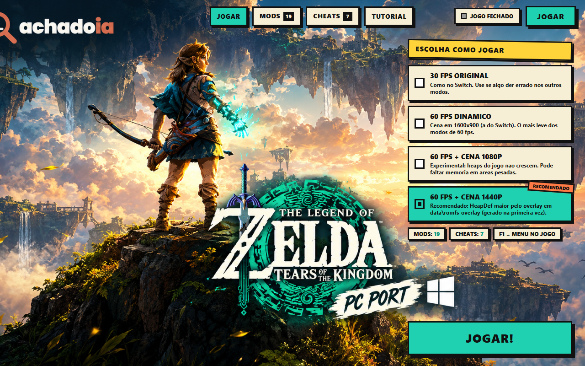
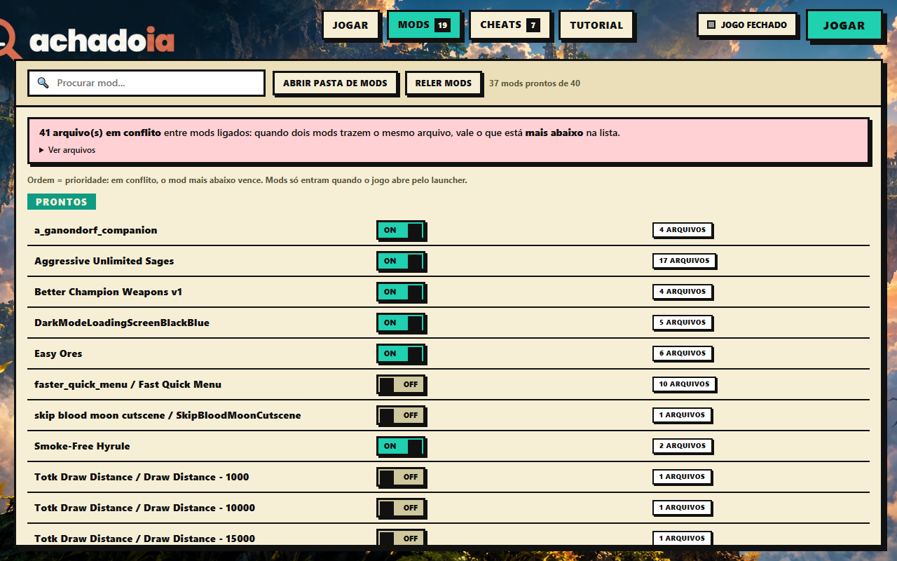
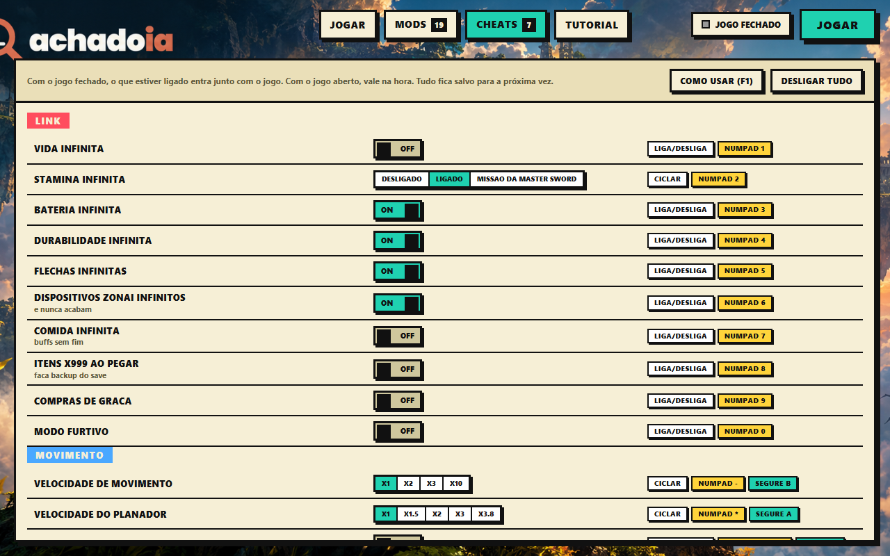
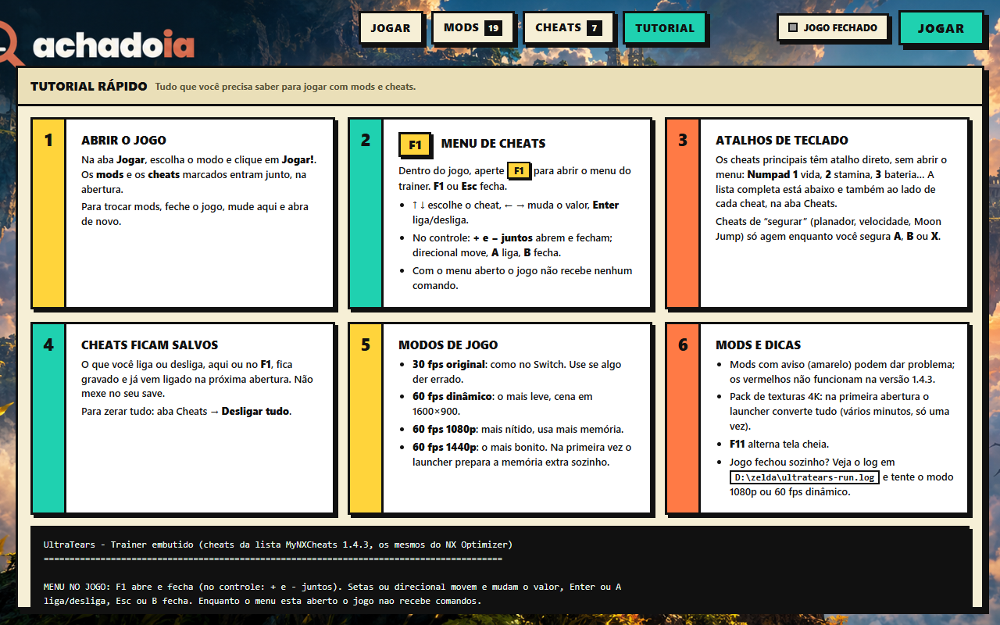

# UltraTears Launcher — Zelda: Tears of the Kingdom (PC)

Launcher estilo WeMod, trainer embutido, 60 FPS e correções de GPU AMD para o **[UltraTears](https://github.com/kuraeow/ultratears)**, o port nativo de *Tears of the Kingdom* 1.4.3 para PC.

> **Este repositório não contém jogo, assets, chaves, firmware nem código da Nintendo.** São só o launcher (Python + HTML) e os arquivos-fonte do UltraTears que alteramos. Você precisa do seu próprio jogo (1.4.3), extraído do seu próprio console, e do builder do UltraTears, como descrito no repositório original. Projeto não afiliado à Nintendo. Licença: GPL-3.0, a mesma do UltraTears.

## Para quem é

Para quem já tem o UltraTears 0.1.0 compilado e rodando (o mesmo port que usamos) e quer colocar por cima:

- um launcher com abas **Jogar / Mods / Cheats / Tutorial**, sem editar `.bat` nem texto;
- **60 FPS reais** (e cena em 1080p/1440p);
- um **trainer** com 28 cheats, ligados pelo launcher, por atalhos ou por um menu dentro do jogo (F1);
- **mods de romfs** com um clique (texturas HD, distância de visão, etc.);
- correções que fizemos para a **Radeon RX 9060 XT** e para crashes em santuário e item.

## O que tem de diferente do UltraTears original

| # | Mudança | Arquivos |
|---|---|---|
| 1 | **GPU AMD**: o modo `VK_EXT_attachment_feedback_loop_dynamic_state` só é usado se a extensão existir. Sem isso a imagem saía escura e chapada. | `src/vk/vk.{h,c}`, `src/gfx/vkb_draw.c` |
| 2 | **Cutscenes pré-renderizadas em preto e branco**: removido um `ResetWriteWatch` extra. | `src/runtime/platform/windows.c` |
| 3 | **60 FPS + passo em tempo real + FPS dinâmico**, portados do `game_patches_v143.c` do [MacNativeGames](https://github.com/ly05010419/MacNativeGames) (MIT, mesmo binário 1.4.3). Resolução da cena opcional (1440p via overlay de heaps). | `tools/lifter/patches.py`, `src/host/frame_step.c`, `tools/make_heap_overlay.py` |
| 4 | **Trainer embutido** (45 sítios de patch, 28 cheats; lista MyNXCheats 1.4.3), menu no jogo, memória compartilhada com o launcher. | `src/host/trainer.c`, `src/vk/present.c`, `src/host/overrides_input.c` |
| 5 | **Crash no santuário** (`no function at 8006eb850`): `br` forçado como label. | `tools/lifter/gen.py`, `patches.py` |
| 6 | **GPU travando ao pegar item** (`DEVICE_LOST`): sampler só é destruído depois que a submissão aberta termina. | `src/gfx/backend_vk.c`, `vkb.h`, `vkb_draw.c` |
| 7 | **Mods de texturas HD**: `make_mod_rstb.py` recalcula a tabela de tamanhos (RSTB) e junta os `HeapDef` de todos os mods; heaps maiores; upload ring que não estoura a memória visível ao host. | `tools/make_mod_rstb.py`, `src/host/{fs,svc}.c`, `src/gfx/vkb_draw.c` |
| 8 | **Shaders assíncronos**: shader novo é compilado em segundo plano e o draw é pulado naquele quadro (menos travadas). Desligue com `TOTK_SHADER_ASYNC=0`. | `src/gfx/vkb_shader.{c,h}` |
| 9 | Até 64 pastas de overlay (eram 16; com muitos mods os últimos sumiam em silêncio). | `src/host/fs.c` |

Os arquivos modificados estão inteiros em `patches-locais/`, com a mesma estrutura de pastas do builder.

## O que o launcher adiciona

- **Jogar**: escolha entre 30 FPS original, 60 FPS dinâmico, 60 FPS + cena 1080p e 60 FPS + cena 1440p (recomendado). Mostra se o jogo está aberto.
- **Mods**: extrai zip/rar/7z, lista cada pasta `romfs`, liga/desliga com um toggle, mostra **conflitos de arquivo** entre mods, avisa de pacotes "Game Version 1.x" (crasham no 1.4.3) e mantém o RSTB/HeapDef gerados.
- **Cheats**: toggle estilo WeMod para cada cheat, com o jogo aberto (vale na hora) ou fechado (entra junto). O que você muda no jogo aparece no launcher, e tudo fica salvo.
- **Tutorial**: guia de uso dentro do próprio launcher.

 

Teclas do trainer: [docs/TRAINER-TECLAS.txt](docs/TRAINER-TECLAS.txt). Notas técnicas dos patches: [docs/NOTAS-TECNICAS.md](docs/NOTAS-TECNICAS.md).

## Como instalar

Pré-requisito: o UltraTears 0.1.0 já compilado a partir do seu jogo 1.4.3 (veja o README e o `BUILDING.md` do projeto original).

1. Deixe esta pasta **ao lado** de `UltraTears-builder-0.1.0-windows-x86_64\` (o launcher procura o builder pelo nome). Exemplo: `D:\zelda\LAUNCHER.py` e `D:\zelda\UltraTears-builder-0.1.0-windows-x86_64\`.
2. Dê dois cliques em **`REAPLICAR-PATCHES.bat`**. Ele copia os arquivos de `patches-locais\` por cima do builder, traduz o jogo de novo (~2 min) e recompila só o que mudou.
3. Abra **`LAUNCHER.bat`**.
4. Coloque seus mods (zip/rar/7z ou pastas) em `mods\` e use a aba Mods.

Depois de atualizar o builder do UltraTears, rode o `REAPLICAR-PATCHES.bat` de novo.

Opcional: coloque uma imagem sua em `launcher\bg.png` para o fundo (não incluímos a nossa).

## Variáveis de ambiente úteis

`TOTK_FPS60`, `TOTK_REALTIME`, `TOTK_MAX_INTERVAL=1` (FPS dinâmico de verdade), `TOTK_RENDER_RES=WxH`, `TOTK_TRAINER=0`, `TOTK_CHEATS=health,stamina,...`, `TOTK_SHADER_ASYNC=0`. O launcher define as certas por você.

## Limitações

- Testado numa Ryzen 5 2600X + Radeon RX 9060 XT 16 GB + 16 GB de RAM (Windows 10). Em outras GPUs não sabemos.
- O jogo é limitado pela CPU (9–21 ms por quadro); 60 FPS fixos não são garantidos.
- Mods que dão crash conhecido (ex.: Dragon Glider, Warglaives sem o Second Quest) vêm desligados por padrão.
- Pacotes de mods "Game Version 1.0.0" não funcionam.
- Faça backup do save antes de usar "itens x999" e "comida infinita".

## Créditos

[UltraTears](https://github.com/kuraeow/ultratears) (kuraeow e colaboradores), [MacNativeGames](https://github.com/ly05010419/MacNativeGames) (60 FPS/tempo real), lista de cheats MyNXCheats (Arch9SK7), interface neobrutalista com a marca [achadoia.com](https://achadoia.com).
